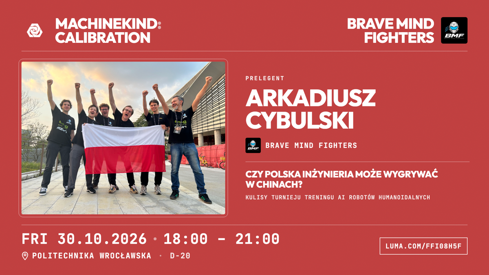

# Karta prelegenta 🎤

Darmowy generator grafik „PRELEGENT” na LinkedIna, Instagrama i ekran na sali.
Wpisujesz imię, tytuł wystąpienia, wgrywasz zdjęcie i klikasz **Pobierz PNG**.
Nie trzeba nic instalować ani umieć programować.



## 👉 Otwórz tutaj: **https://machinekind.github.io/karta-prelegenta/**

---

## Jak zrobić kartę w 2 minuty

1. **Otwórz link** powyżej. Najlepiej w Chrome na komputerze.
2. Po lewej stronie jest formularz, po prawej podgląd. **Wszystko, co wpiszesz, od razu widać na karcie.**
3. **Imię i nazwisko** wpisz w pierwszym polu. Naciśnij Enter, żeby nazwisko było w drugiej linijce.
4. **Zdjęcie:** kliknij „Wybierz plik” przy polu *Zdjęcie* i wskaż zdjęcie z komputera.
   Jeśli ucina głowę, przesuń suwak *Kadr zdjęcia* w lewo (pokaże więcej góry).
5. **Tytuł wystąpienia** i **podtytuł** wpisz w sekcji *Wystąpienie*.
   Jeśli tytuł ładniej wygląda w dwóch linijkach, wstaw Enter tam, gdzie chcesz przełamać.
6. **Organizacja gościa** (prawy górny róg): wpisz nazwę i wgraj kwadratowe logo.
   Nie ma organizacji? Odznacz dwa kwadraciki pod logo i po sprawie.
7. **Wydarzenie:** sprawdź datę, godzinę, salę i link.
8. Kliknij czerwony przycisk **Pobierz PNG**. Plik `karta_imie_nazwisko_1920x1080.png` zapisze się w *Pobranych*.
9. Wrzuć go na LinkedIna jako zdjęcie w poście. Gotowe! 🎉

### Kilka rzeczy, które warto wiedzieć

- **Twoje zdjęcia nigdzie nie wychodzą.** Wszystko dzieje się w przeglądarce na Twoim komputerze.
- **Strona pamięta teksty**, więc przy następnej karcie zmieniasz tylko imię i tytuł. Zdjęcie i logo trzeba wgrać ponownie.
- **„Przywróć przykład”** czyści wszystko i wraca do karty Arkadiusza.
- **Coś nie działa?** Odśwież stronę (Ctrl+R albo Cmd+R) i spróbuj w Chrome.
- **Za długi tekst wychodzi poza kartę?** Skróć go albo dodaj Enter w środku.
- **Najlepsze zdjęcie** jest poziome, ostre i ma co najmniej 1600 px szerokości.
- **Logo** najlepiej kwadratowe, PNG, z kolorowym albo przezroczystym tłem.

---

## Chcę mieć własną wersję (np. inne wydarzenie albo kolor)

Nie musisz nic instalować, wystarczy konto na GitHubie.

1. Kliknij **Fork** w prawym górnym rogu tej strony. Masz teraz własną kopię.
2. W swojej kopii otwórz plik `index.html` i kliknij ikonkę ołówka ✏️.
3. Zmień to, co chcesz:
   - **Domyślne teksty** to wartości w formularzu, np. `value="Fri 30.10.2026"`. Wpisz swoje.
   - **Kolor tła** to `#BE3E3E`. Użyj Ctrl+F, znajdź i zamień na swój, np. `#1E5BD8`.
   - **Logo wydarzenia** podmień, wgrywając plik o tej samej nazwie do folderu `obrazki/`
     (*Add file → Upload files*).
4. Kliknij **Commit changes**.
5. Włącz stronę: **Settings → Pages → Branch: `main` → Save.**
   Po minucie strona będzie pod adresem `https://TWOJA-NAZWA.github.io/karta-prelegenta/`.

### Uruchomienie na swoim komputerze (dla chętnych)

Pobierz repo (**Code → Download ZIP**), rozpakuj, otwórz terminal w tym folderze i wpisz:

```
python3 -m http.server 8000
```

Potem wejdź w przeglądarce na http://localhost:8000.
Samo dwuklikanie `index.html` pokaże podgląd, ale przycisk *Pobierz PNG* może wtedy nie zadziałać.

---

## Co jest w środku

| Plik | Do czego |
|---|---|
| `index.html` | Cała strona: formularz, wygląd karty i eksport do PNG |
| `obrazki/` | Logo, przykładowe zdjęcie i przykładowa karta |
| `czcionki/` | Czcionki Outfit i JetBrains Mono, żeby PNG wyglądał zawsze tak samo |

Obrazek PNG robi biblioteka [html-to-image](https://github.com/bubkoo/html-to-image).

## Licencja

Kod jest open source na licencji **Apache 2.0** (plik `LICENSE`). Możesz go używać, zmieniać i rozdawać, także komercyjnie.

Czcionki są na licencji SIL Open Font License (pliki w `czcionki/`).
Logo Machinekind, logo Brave Mind Fighters i przykładowe zdjęcie **nie są** objęte licencją Apache.
Należą do swoich właścicieli i są tu tylko jako przykład. W swojej wersji podmień je na własne. Szczegóły w pliku `NOTICE`.

---

Zrobione przez [Machinekind Robotics](https://www.linkedin.com/company/135344032/) na wydarzenie **Machinekind: Calibration**, Wrocław 2026.
